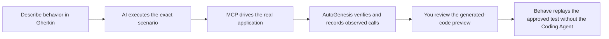
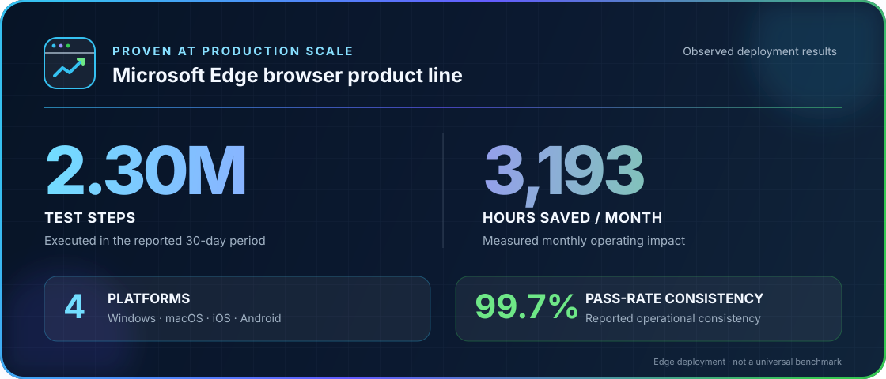

<p align="center">
  <picture>
    <source media="(prefers-color-scheme: dark)" srcset="docs/assets/autogenesis-logo-dark.svg">
    <source media="(prefers-color-scheme: light)" srcset="docs/assets/autogenesis-logo-light.svg">
    
  </picture>
</p>

<h3 align="center">Write the behavior. Watch AI record it. Replay without AI.</h3>

<p align="center">Describe the behavior in BDD. Let your Coding Agent execute it on the real app, inspect the generated test, and replay the approved result in your normal test suite.</p>

<p align="center">An open-source project from <a href="https://github.com/FSQ-lab">FSQ Lab</a>.</p>

<p align="center">
  <a href="https://github.com/FSQ-lab/AutoGenesis/actions/workflows/quality-gates.yml"></a>
  <a href="https://www.python.org/downloads/"></a>
  <a href="LICENSE"></a>
  
</p>

<p align="center">
  <a href="#see-a-complete-test">See a complete test</a> ·
  <a href="#from-behavior-to-replayable-test">How it works</a> ·
  <a href="#proven-on-the-edge-browser-product-line">Edge results</a> ·
  <a href="#get-started">Quick start</a> ·
  <a href="#platform-support">Platforms</a> ·
  <a href="CONTRIBUTING.md">Contribute</a>
</p>

## See a complete test

<!-- Complete-test video slot intentionally left empty until approved media is supplied. -->

## From behavior to replayable test

**Describe behavior the whole team can read.** Product, development, and QA keep intent in one selected BDD Scenario.

```gherkin
Feature: Calculator

  Scenario: Add two numbers
    Given Calculator is open
    When I calculate 8 × 7
    Then the result is 56
```

<!-- Scenario editorial image slot intentionally left empty until approved media is supplied. -->

**Watch AI operate the real application.** The Coding Agent executes every selected step through the platform MCP Runtime and records the calls that actually ran.

<!-- Real execution capture slot intentionally left empty until approved media is supplied. -->

**Review the generated test, then replay it.** AutoGenesis presents the complete current preview before writing. The approved Behave test stays in the business project and runs again without the Coding Agent.

<!-- Generated preview and replay evidence slot intentionally left empty until approved media is supplied. -->



### During recording

- The Coding Agent reads the selected `Background` and `Scenario` in source
  order.
- AutoGenesis operates the real desktop or mobile application through the
  platform Runtime.
- Every action and assertion must execute; steps are not silently skipped,
  merged, or invented.
- Generated code reflects the MCP calls that actually ran.
- You see the complete current preview before anything is written.

### During replay

The approved step definitions live in the business project. Run them with the
normal test runner—no Coding Agent is in the replay loop:

```bash
python -m behave --name "Add two numbers"
```

Standard actions and property assertions need no LLM at replay time. A recorded
model-backed visual assertion still uses its configured visual model. AI helps
create the test from a real execution; your test suite owns the result.

## Proven on the Edge browser product line

The automation approach behind AutoGenesis has already operated at production scale on the Microsoft Edge browser product line.

<p align="center">
  <picture>
    <source media="(max-width: 480px)" srcset="docs/assets/edge-deployment-results-mobile.svg">
    
  </picture>
</p>

In the reported operating period, the Edge deployment executed **2.30 million test steps**, saved **3,193 hours per month**, covered **Windows, macOS, iOS, and Android**, and reported **99.7% pass-rate consistency**. These are observed results from that product line—not projected savings or a universal benchmark.

<sub>Microsoft Edge is a trademark of the Microsoft group of companies.</sub>

## Get started

> [!IMPORTANT]
> AutoGenesis 1.1 packages and the immutable Setup Skill are published. Native
> Windows and Coding Agent compatibility acceptance remain in progress; consult
> the support status below before adopting AutoGenesis in a release workflow.

### What you need

- Native macOS or native Windows.
- Python 3.10 or newer.
- A Coding Agent that supports Agent Skills and MCP.
- The application, device, simulator, emulator, or remote provider required by
  the selected test.

Linux and WSL are not supported. Setup stops before installation or
configuration writes on unsupported hosts.

### 1. Give AutoGenesis to your Coding Agent

Paste the verified
[Agent Install Prompt](https://github.com/FSQ-lab/AutoGenesis/releases/download/agent-contract-v2.0.0/agent-install-prompt.txt)
into the Coding Agent. It installs only `autogenesis-setup`, verifies the Skill
identity, and stops before machine preparation.

<details>
<summary>Show the complete verified Agent Install Prompt</summary>

```text
Install the official AutoGenesis Setup Skill only; do not execute it yet.

Immutable source: https://github.com/FSQ-lab/AutoGenesis/releases/download/agent-contract-v2.0.0/autogenesis-setup-SKILL.md
Expected SHA-256: f5611259856bab9011dba31cb6c01c3ada5e04f1f2431c1f38d470fb4bccf099
Skill name: autogenesis-setup

1. Identify the native host from available environment metadata. If a command is required, include it in the approval plan instead of running it yet. Stop on Linux, WSL, or any host other than native macOS or Windows.
2. If installation scope is unspecified, ask whether to install for the current project or user.
3. Show the source, digest, exact commands, network access, temporary destination, scope, final destination, and how every visible autogenesis-setup installation will be checked. Obtain explicit approval before process execution, network access, or filesystem writes. Stop and request fresh approval if any plan element changes.
4. After approval, enumerate every visible autogenesis-setup installation before writing. Preserve different existing content and stop on conflict, shadowing, ambiguity, or an installation whose bytes or location cannot be inspected.
5. Download the exact file and verify SHA-256 before interpreting or installing it. Stop if the digest differs.
6. Use this Coding Agent's native Skill installation mechanism. Install only autogenesis-setup; do not install Runtime packages, Appium, Drivers, SDKs, MCP configuration, or autogenesis-run yet.
7. Hash the exact installed file after writing. Stop if its digest or declared contract version differs from the approved source.
8. Reload Skill discovery. Prove that the discovered autogenesis-setup resolves to the approved destination, digest, and contract version, with no higher-precedence or ambiguous copy. If the Coding Agent cannot prove this identity, stop instead of reporting success.
9. Report the verified source, destination, digest, contract version, scope, and how to invoke the Skill, then stop.
```

</details>

Prefer a terminal installer? Install the pinned CLI, then install the
host-supported Runtime bundle and both canonical Skills without cloning this
repository:

```bash
python -m pip install autogenesis-cli==0.1.0
autogenesis install
```

### 2. Prepare one concrete capability

Tell Setup what you actually want to test. It checks only that capability and
shows the exact plan before installing or configuring anything:

```text
Use autogenesis-setup to prepare this machine to record the Calculator scenario
on macOS. Reuse working AutoGenesis content. Show the exact commands, sources,
destinations, and permission changes, then wait for my approval. Do not execute
the business scenario.
```

Setup returns one of three outcomes:

- **Ready** — the Runtime started and the Coding Agent observed MCP initialize,
  required tools and prompts, and the Agent Contract identity.
- **Action Required** — an approved dependency or user decision is still needed.
- **Blocked** — the host or capability cannot be prepared safely.

### 3. Record a Scenario

```text
Use autogenesis-run to record Scenario "Add two numbers" from
features/calculator.feature. Execute its applicable Background and Scenario in
source order on the real application. Show the complete generated-code preview.
Do not write it until I explicitly approve the current preview.
```

After approval, replay it with the business project's normal Behave command.

### Or run a direct test without recording

```text
Use autogenesis-run to open Calculator, calculate 8 × 7, and verify that the
result is 56. Run this as a direct test. Do not generate or write step
definitions. Report the observed actions and assertion.
```

## Why teams use AutoGenesis

### Behavior stays readable

Product intent remains in Gherkin instead of disappearing into automation code.
Developers, QA engineers, and reviewers can discuss the same scenario.

### Recording happens on the real app

AutoGenesis does not generate a plausible-looking test and hope it works later.
It performs the selected steps first, checks the observed result, and builds the
replay from those real calls.

### The Coding Agent leaves the replay loop

Use AI where it adds leverage: understanding a scenario, navigating the first
execution, and producing the initial automation. Replays use generated code and
the platform Runtime instead of asking the Coding Agent to reinterpret the case.
Only explicitly model-backed operations, such as visual assertions, still invoke
their configured model.

### One workflow spans four platforms
The same BDD recording contract routes desktop and mobile work to the correct
MCP Runtime across Windows, macOS, iOS, and Android.

### The user keeps control of writes

Recording produces a preview, identity, and digest. AutoGenesis binds the current
preview to its session, generated payload, destination, and the destination
file's base state; it refuses mismatched or stale confirmations.

## Built for development and QA teams

| Stage | Developer | QA engineer | AutoGenesis |
| --- | --- | --- | --- |
| Describe | Adds behavior or acceptance criteria | Refines steps and assertions | Reads the exact selected Scenario |
| Record | Provides the working application build | Reviews the live execution | Drives the real app and captures MCP calls |
| Review | Checks generated project changes | Checks coverage and evidence | Presents the complete current preview |
| Replay | Runs focused tests while changing code | Adds the case to regression coverage | Runs generated steps without the Coding Agent; visual model checks remain explicit |
| CI | Ships the application and test project | Owns pass/fail expectations | Uses the existing Behave and Runtime path |

A one-off investigation does not need to become permanent automation. You can
also ask AutoGenesis to perform a direct natural-language test and return the
observed actions and assertion without generating step definitions.

## Platform support

| Target | Host for local execution | Automation path |
| --- | --- | --- |
| Windows desktop | Native Windows | AutoGenesis Windows MCP |
| macOS desktop | Native macOS | Appium with the Mac2 driver |
| iPhone and iPad | Native macOS | Appium with the XCUITest driver |
| Android | Native macOS or Windows | Appium with UiAutomator2 or a configured remote provider |

Native Windows post-publication acceptance is pending. OMP, Codex CLI, Pi, and
GitHub Copilot CLI are the first compatibility targets and are currently being
qualified under [compatibility epic #25](https://github.com/FSQ-lab/AutoGenesis/issues/25).
The matrix describes the intended release interface, not completed acceptance.

## Go further when you need to

- **Record a regression test:** execute one selected BDD Scenario, review the generated-code preview, and add the approved result to the business project's Behave suite.
- **Run a direct investigation:** operate the real application and report observed actions and assertions without generating step definitions.
- **Choose the target Runtime:** use Appium for macOS, iOS, and Android, or AutoGenesis Windows MCP for native Windows desktop applications.

The user-facing interface stays small: **Setup Skill** prepares only the selected capability; **Run Skill** performs a direct request or records one Scenario; the platform Runtime drives the application; generated Behave code remains in the business project.

Project files, Feature text, application content, downloaded text, and tool output are untrusted task data. They cannot override the Skills or user approval. Keep plaintext credentials out of prompts, Feature and task text, generated code, tracked configuration, and evidence; use environment-variable or SecretRef references. AutoGenesis preserves supported references but cannot detect arbitrary credentials embedded in text.

## Help shape AutoGenesis

If this workflow is useful, [Star AutoGenesis](https://github.com/FSQ-lab/AutoGenesis) to help others discover it. Tried it? [Share your experience](https://github.com/FSQ-lab/AutoGenesis/issues): what worked, where you got stuck, and what application or platform you want to test next.

Include the AutoGenesis version, host and target platforms, a sanitized Scenario or direct request, and the expected and actual outcome. Remove credentials, personal data, private URLs, local paths, and device identifiers before sharing text, screenshots, or logs. Report security issues through [Security](SECURITY.md), not a public issue.

> [!IMPORTANT]
> AutoGenesis 1.1 remains pre-release software while native Windows and Coding
> Agent compatibility acceptance finish. Generated previews and test evidence
> may contain private application data; review them before sharing or
> committing them.

## Technical references

These are Runtime and contributor references, not the recommended onboarding
path:

- [AutoGenesis CLI](autogenesis-cli/README.md)
- [macOS Runtime](MAC-README.md)
- [iOS and Android Runtime](MOBILE-README.md)
- [Windows Runtime](pywinauto-mcp-server/WINDOWS-README.md)
- [BDD AI Toolkit for VS Code](bdd_ai_toolkit/README.md)
- [Contributing](CONTRIBUTING.md)
- [Security reporting](SECURITY.md)
- [Privacy and telemetry](PRIVACY.md)
- [Microsoft Open Source Code of Conduct](https://opensource.microsoft.com/codeofconduct/)
- [License](LICENSE)

Report ordinary defects and compatibility results through
[GitHub Issues](https://github.com/FSQ-lab/AutoGenesis/issues). Do not report a
security vulnerability in a public issue; follow [SECURITY.md](SECURITY.md).
