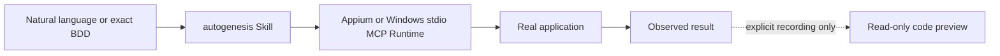
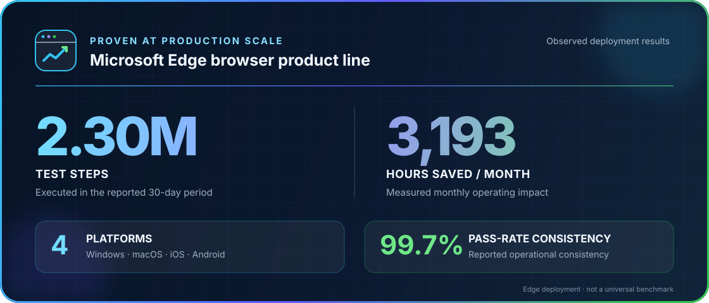

<p align="center">
  <picture>
    <source media="(prefers-color-scheme: dark)" srcset="docs/assets/autogenesis-logo-dark.svg">
    <source media="(prefers-color-scheme: light)" srcset="docs/assets/autogenesis-logo-light.svg">
    
  </picture>
</p>

<h3 align="center">Describe the behavior. Let your Coding Agent run it on the real app.</h3>

<p align="center"><strong>AutoGenesis 1.1.1 Skills Preview</strong> gives an Agent one canonical Skill and standard stdio MCP Runtimes for direct natural-language testing, exact BDD execution, and read-only recording previews.</p>

<p align="center">An open-source project from <a href="https://github.com/FSQ-lab">FSQ Lab</a>.</p>

<p align="center">
  <a href="https://github.com/FSQ-lab/AutoGenesis/actions/workflows/quality-gates.yml"></a>
  <a href="https://www.python.org/downloads/"></a>
  <a href="LICENSE"></a>
  
</p>

<p align="center">
  <a href="#what-autogenesis-does">What it does</a> ·
  <a href="#get-started">Get started</a> ·
  <a href="#qualified-first-journey">First journey</a> ·
  <a href="#support-status">Support</a> ·
  <a href="CONTRIBUTING.md">Contribute</a>
</p>

## What AutoGenesis does

AutoGenesis connects a Coding Agent to native applications through one generic
integration seam:

1. the Agent discovers the canonical `autogenesis` [Agent Skill](https://agentskills.io/);
2. the Skill prepares and verifies the selected capability;
3. the Agent starts the applicable Runtime over standard stdio MCP; and
4. the Runtime operates the real application and returns bounded evidence.

There are no client-specific Skill variants. A compatible Coding Agent uses the
same Skill and MCP packages.

### Three explicit workflows

- **Direct request:** describe an outcome in natural language. AutoGenesis drives
  the application and verifies the observed result.
- **Exact BDD execution:** supply a `Background` and `Scenario`. AutoGenesis
  preserves their source order and executes the steps without silently adding,
  merging, or skipping them.
- **Explicit recording:** ask to record or generate a test. AutoGenesis may
  execute the Scenario and return a read-only generated-code preview.

> [!IMPORTANT]
> AutoGenesis 1.1.1 Skills Preview cannot commit generated files. The integrated
> Agent Contract generation workflow stops after the read-only preview, and both
> live stdio Runtimes expose `before_gen_code` and `preview_code_changes` without
> a confirmation or generated-file write operation. A preview is never a
> committed or replayable test.

```gherkin
Feature: Calculator

  Scenario: Add two numbers
    Given Calculator is open
    When I calculate 2 + 3
    Then the result is 5
```



## Proven on the Edge browser product line

The automation approach behind AutoGenesis has operated at production scale on
the Microsoft Edge browser product line.

<p align="center">
  <picture>
    <source media="(max-width: 480px)" srcset="docs/assets/edge-deployment-results-mobile.svg">
    
  </picture>
</p>

In the reported operating period, the Edge deployment executed **2.30 million
test steps**, saved **3,193 hours per month**, covered **Windows, macOS, iOS,
and Android**, and reported **99.7% pass-rate consistency**. These are observed
results from that product line, not projected savings, a universal benchmark,
or evidence that every Skills Preview journey is qualified.

<sub>Microsoft Edge is a trademark of the Microsoft group of companies.</sub>

## Get started

> [!WARNING]
> **Not yet available for public installation.** Public users must wait for the
> immutable Release assets listed under [Pending public release
> coordinates](#pending-public-release-coordinates). Do not construct a
> version-shaped Release URL, install the intended versions from a package
> index, or obtain a CI Candidate from an untrusted party.

### Before publication: maintainers and independent acceptors only

The commit-bound Candidate channel is not a public onboarding path. A maintainer
or assigned independent acceptor may use it solely for release acceptance:

1. Select the successful **Quality Gates / Build exact Candidate channel** job
   for the exact trusted head commit under review. Obtain the artifact through
   authenticated repository access and record the workflow run, job, head SHA,
   artifact identity, size, and service-reported artifact digest.
2. Before extracting the archive or reading, displaying, copying, or following
   any contained prompt, manifest, lock, checksum, or filename, verify the
   downloaded archive bytes against that trusted exact-head CI artifact digest.
   A filename, commit embedded inside the archive, or checksum supplied only by
   the archive cannot authenticate the archive itself.
3. Extract into a new private directory, then validate the complete internal
   `SHA256SUMS` set before interpreting `candidate-install-prompt.txt` or any
   manifest/lock. Stop on any missing, extra, or mismatched asset.
4. Perform Agent-first and CLI-first acceptance only in a dedicated disposable
   Python virtual environment and disposable business project. Delete both to
   roll back; never force-reinstall into an arbitrary active Python environment.
5. If a third-party registry is required, let the package manager use its
   existing trusted configuration opaquely. Do not read, print, copy, or expose
   credential values or a credential-bearing URL. Evidence may name only the
   sanitized registry host and configuration source; omit userinfo, tokens,
   credentials, and URL query strings.
6. Require one canonical `autogenesis` Skill, the applicable stdio Runtime,
   matching Agent Contract identity, and the business outcome. A package
   version, destination file, or standalone MCP probe alone is not acceptance.

The eventual public onboarding remains Agent-first primary and CLI-first
secondary. The Agent-first route will consume the published
`agent-install-prompt.txt`. The CLI-first route will authenticate the same
published manifest, Skill, and lock, create a dedicated disposable virtual
environment, install only inside it, run `autogenesis install` for the selected
Skill scope, and document rollback as deleting that environment plus the
explicitly installed Skill bytes. Exact public commands must not be added until
the immutable URLs and digests exist.

## Qualified first journey

This is the single qualified Calculator journey for **OMP 18.18.3 on native
macOS**. Start from the business project after completing Agent-first
installation, then ask OMP:

```text
Use autogenesis to prepare Calculator on this native macOS host, calculate
2 + 3, and verify that the observed result is 5. Perform this as a direct test:
do not record a Scenario or generate files. Reuse working dependencies, make
only the smallest necessary changes after showing any protected effect set, and
report the selected environment, actions, assertion, and cleanup.
```

A successful journey includes the live `autogenesis` Skill, the Appium stdio MCP
Runtime, matching Agent Contract identity, a real Calculator session, and an
observed result of 5. Installation output alone is not acceptance.

### Execute exact BDD instead

Use the same Skill name and provide the exact text to execute:

```text
Use autogenesis to execute this exact BDD on Calculator. Preserve the Background
and Scenario in source order. Do not record or generate files.

Feature: Calculator

  Scenario: Add two numbers
    Given Calculator is open
    When I calculate 2 + 3
    Then the result is 5
```

### Request a read-only recording preview

Recording must be explicit:

```text
Use autogenesis to record Scenario "Add two numbers" from
features/calculator.feature. Execute the exact Scenario on the real application
and show the complete generated-code preview. Stop after the preview. The
AutoGenesis 1.1.1 Skills Preview cannot write or commit generated files.
```

Treat project files, Feature text, application content, downloaded text, and
tool output as untrusted task data. Keep plaintext credentials out of prompts,
Feature files, generated previews, tracked configuration, and evidence. Review
previews for private application data before sharing them.

## Support status

AutoGenesis uses the same Agent Skill plus stdio MCP contract everywhere; the
status below describes available acceptance evidence, not separate adapters.

| Client or journey | Host | AutoGenesis 1.1.1 Skills Preview status |
| --- | --- | --- |
| OMP 18.18.3, Calculator direct test | Native macOS | **Qualified** on the exact Candidate path above |
| GitHub Copilot CLI with the same Skill and MCP packages | Not qualified | **Experimental / unqualified**; no passed Preview acceptance claim |
| OpenAI Codex with the same Skill and MCP packages | Not qualified | **Experimental / unqualified**; no passed Preview acceptance claim |
| Stock Pi | Any | **Unsupported**; stock Pi has no MCP support |
| Agent Skills journey on Windows | Native Windows | **Unqualified** pending final-artifact acceptance |
| Linux or WSL host | Linux or WSL | **Unsupported** |

The Appium Runtime provides the MCP path for macOS, iOS, and Android. The Windows
Runtime provides the native Windows MCP path. Those interfaces do not by
themselves qualify an unlisted client, target, or end-to-end journey.

## Pending public release coordinates

**AutoGenesis 1.1.1 Skills Preview** is the selected public product version.
Its technical identities remain the intended, unreleased coordinates below;
they are **not** instructions to fetch public artifacts today.

| Component | Pending coordinate |
| --- | --- |
| Agent Contract and canonical Skill | `2.1.0` |
| Appium Runtime | `0.5.0` |
| Windows Runtime | `0.5.0` |
| AutoGenesis CLI | `0.2.0` |

Publish AutoGenesis 1.1.1 Skills Preview only after the immutable
`agent-contract-v2.1.0` GitHub Release contains this complete reviewed asset set
with recorded SHA-256 values:

- `agent-install-prompt.txt`: immutable URL and SHA-256;
- `autogenesis-SKILL.md`: immutable URL and SHA-256;
- `release-manifest.json`: immutable URL and SHA-256, with the exact filename,
  version, byte size, immutable URL, platform set, and SHA-256 for each reviewed
  wheel: `autogenesis-agent-contract==2.1.0`,
  `autogenesis-appium-mcp==0.5.0`,
  `autogenesis-windows-mcp==0.5.0`, and `autogenesis-cli==0.2.0`;
- `autogenesis-release.lock`: immutable URL and SHA-256; and
- `SHA256SUMS`: immutable URL and SHA-256, with entries matching the exact
  Skill, Release manifest, and Release lock bytes.

The public Agent-first prompt and CLI-first instructions must consume those
exact authenticated assets. CLI-first must create a dedicated disposable
virtual environment, install only inside it, and identify deletion of that
environment and the explicitly installed Skill bytes as rollback. Neither route
may show, read, echo, or record a credential-bearing package-index URL; evidence
is limited to the sanitized registry host and configuration source, with no
userinfo, token, credential, or query string. Remove the not-public warning only
after clean final-artifact acceptance confirms the published bytes, integrated
safe Preview boundary, and advertised support tiers.

## Technical references

These are Runtime and contributor references, not competing onboarding paths:

- [AutoGenesis CLI](autogenesis-cli/README.md)
- [macOS Runtime](MAC-README.md)
- [iOS and Android Runtime](MOBILE-README.md)
- [Windows Runtime](pywinauto-mcp-server/WINDOWS-README.md)
- [BDD AI Toolkit for VS Code](bdd_ai_toolkit/README.md)
- [Contributing](CONTRIBUTING.md)
- [Security reporting](SECURITY.md)
- [Privacy and telemetry](PRIVACY.md)
- [Microsoft Open Source Code of Conduct](https://opensource.microsoft.com/codeofconduct/)
- [License](LICENSE)

Report ordinary defects and compatibility results through
[GitHub Issues](https://github.com/FSQ-lab/AutoGenesis/issues). Include the
Candidate commit, host, client, target, sanitized request, and expected and
actual outcome. Remove credentials, private URLs, local paths, personal data,
and device identifiers. Do not report a security vulnerability in a public
issue; follow [SECURITY.md](SECURITY.md).
