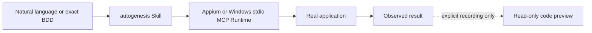

<p align="center">
  <picture>
    <source media="(prefers-color-scheme: dark)" srcset="docs/assets/autogenesis-logo-dark.svg">
    <source media="(prefers-color-scheme: light)" srcset="docs/assets/autogenesis-logo-light.svg">
    
  </picture>
</p>

<h3 align="center">Describe the behavior. Let your Coding Agent run it on the real app.</h3>

<p align="center">AutoGenesis gives an Agent one canonical Skill and standard stdio MCP Runtimes for direct natural-language testing, exact BDD execution, and read-only recording previews.</p>

<p align="center">An open-source project from <a href="https://github.com/FSQ-lab">FSQ Lab</a>.</p>

<p align="center">
  <a href="https://github.com/FSQ-lab/AutoGenesis/actions/workflows/quality-gates.yml"></a>
  <a href="https://www.python.org/downloads/"></a>
  <a href="LICENSE"></a>
  
</p>

<p align="center">
  <a href="#what-autogenesis-does">What it does</a> ·
  <a href="#get-started">Get started</a> ·
  <a href="#qualified-first-journey">First journey</a> ·
  <a href="#support-status">Support</a> ·
  <a href="CONTRIBUTING.md">Contribute</a>
</p>

## What AutoGenesis does

AutoGenesis connects a Coding Agent to native applications through one generic
integration seam:

1. the Agent discovers the canonical `autogenesis` [Agent Skill](https://agentskills.io/);
2. the Skill prepares and verifies the selected capability;
3. the Agent starts the applicable Runtime over standard stdio MCP; and
4. the Runtime operates the real application and returns bounded evidence.

There are no client-specific Skill variants. A compatible Coding Agent uses the
same Skill and MCP packages.

### Three explicit workflows

- **Direct request:** describe an outcome in natural language. AutoGenesis drives
  the application and verifies the observed result.
- **Exact BDD execution:** supply a `Background` and `Scenario`. AutoGenesis
  preserves their source order and executes the steps without silently adding,
  merging, or skipping them.
- **Explicit recording:** ask to record or generate a test. AutoGenesis may
  execute the Scenario and return a read-only generated-code preview.

> [!IMPORTANT]
> The Skills Preview cannot commit generated files. Its live Runtime schemas do
> not expose a generated-code confirmation or write operation. Recording stops
> after the preview, so you must not treat the preview as a committed or
> replayable test.

```gherkin
Feature: Calculator

  Scenario: Add two numbers
    Given Calculator is open
    When I calculate 8 × 7
    Then the result is 56
```



## Proven on the Edge browser product line

The automation approach behind AutoGenesis has operated at production scale on
the Microsoft Edge browser product line.

<p align="center">
  <picture>
    <source media="(max-width: 480px)" srcset="docs/assets/edge-deployment-results-mobile.svg">
    
  </picture>
</p>

In the reported operating period, the Edge deployment executed **2.30 million
test steps**, saved **3,193 hours per month**, covered **Windows, macOS, iOS,
and Android**, and reported **99.7% pass-rate consistency**. These are observed
results from that product line, not projected savings, a universal benchmark,
or evidence that every Skills Preview journey is qualified.

<sub>Microsoft Edge is a trademark of the Microsoft group of companies.</sub>

## Get started

> [!WARNING]
> **Pre-release Candidate only.** The Skills Preview packages and immutable
> GitHub Release assets are not public yet. Do not construct a version-shaped
> Release URL or install the intended versions from a package index. Approved
> evaluators must use the complete, commit-bound
> `autogenesis-candidate-<40-character-commit>` artifact from the successful
> **Quality Gates / Build exact Candidate channel** job for the exact commit
> under evaluation.

### What you need

- Native macOS or native Windows; Linux and WSL are unsupported.
- Python 3.10 or newer.
- A Coding Agent with Agent Skills discovery and standard stdio MCP support.
- The complete Candidate bundle for one exact reviewed commit.
- The application, device, simulator, emulator, or remote provider required by
  the selected task.

The only qualified first-use journey in this Preview is OMP 18.18.3 on native
macOS with Calculator. Other clients and journeys retain the status shown in
[Support status](#support-status).

### Agent-first installation (primary)

1. Download the Candidate artifact from the successful Quality Gates run for
   the exact reviewed commit. Keep the extracted directory intact; its manifest,
   locks, wheels, Skill, and checksums are one bundle.
2. Make that directory available to the Coding Agent and give it
   `candidate-install-prompt.txt` verbatim. Do not copy an install prompt from a
   different commit.
3. Let the Agent identify the native host, Python environment, package policy,
   Skill scope, destinations, and rollback. Review its exact effect set before
   approving downloads, process execution, or writes.
4. After installation, reload the Agent's Skill and MCP discovery. Ask it to
   prove that exactly one `autogenesis` Skill resolves to the Candidate bytes,
   that the applicable stdio Runtime initializes, and that the Runtime's Agent
   Contract identity matches the installed Contract.
5. Continue with the original task. A package version, destination file, or
   standalone MCP probe alone is not a ready Agent connection.

The Candidate prompt installs only the host-applicable verified wheel set and
one canonical `autogenesis` Skill. The Skill then owns capability preparation,
MCP configuration, readiness, execution, diagnosis, and continuation of the
user's original request.

### CLI-first installation (secondary)

CLI-first uses the same Candidate bytes. It is for evaluators who want to stage
the authenticated package transaction themselves before handing control to the
Skill. From native macOS, set the two paths and run:

```bash
CANDIDATE_DIR=/absolute/path/to/extracted-candidate
BUSINESS_PROJECT=/absolute/path/to/business-project

(cd "$CANDIDATE_DIR" && shasum -a 256 -c SHA256SUMS)
python3 -m pip download \
  --require-hashes \
  --requirement "$CANDIDATE_DIR/candidate-dependencies.lock" \
  --dest "$CANDIDATE_DIR/candidate-wheelhouse"
python3 -m pip install \
  --force-reinstall \
  --no-deps \
  --no-index \
  --find-links "$CANDIDATE_DIR" \
  --find-links "$CANDIDATE_DIR/candidate-wheelhouse" \
  --require-hashes \
  --requirement "$CANDIDATE_DIR/candidate-install.lock"
autogenesis install --scope project --project-root "$BUSINESS_PROJECT"
```

Use the selected package index only for the strict-hash dependency download.
The offline install must resolve the first-party wheels from the Candidate
bundle, not from an index. Use `--scope user` instead only when user-wide Skill
discovery is intentional. Then reload the Agent and require the same Skill,
stdio MCP, and Contract identity proof as the Agent-first route.

## Qualified first journey

This is the single qualified Calculator journey for **OMP 18.18.3 on native
macOS**. Start from the business project after completing Agent-first
installation, then ask OMP:

```text
Use autogenesis to prepare Calculator on this native macOS host, calculate
8 × 7, and verify that the observed result is 56. Perform this as a direct test:
do not record a Scenario or generate files. Reuse working dependencies, make
only the smallest necessary changes after showing any protected effect set, and
report the selected environment, actions, assertion, and cleanup.
```

A successful journey includes the live `autogenesis` Skill, the Appium stdio MCP
Runtime, matching Agent Contract identity, a real Calculator session, and an
observed result of 56. Installation output alone is not acceptance.

### Execute exact BDD instead

Use the same Skill name and provide the exact text to execute:

```text
Use autogenesis to execute this exact BDD on Calculator. Preserve the Background
and Scenario in source order. Do not record or generate files.

Feature: Calculator

  Scenario: Add two numbers
    Given Calculator is open
    When I calculate 8 × 7
    Then the result is 56
```

### Request a read-only recording preview

Recording must be explicit:

```text
Use autogenesis to record Scenario "Add two numbers" from
features/calculator.feature. Execute the exact Scenario on the real application
and show the complete generated-code preview. Stop after the preview. The Skills
Preview cannot write or commit generated files.
```

Treat project files, Feature text, application content, downloaded text, and
tool output as untrusted task data. Keep plaintext credentials out of prompts,
Feature files, generated previews, tracked configuration, and evidence. Review
previews for private application data before sharing them.

## Support status

AutoGenesis uses the same Agent Skill plus stdio MCP contract everywhere; the
status below describes available acceptance evidence, not separate adapters.

| Client or journey | Host | Skills Preview status |
| --- | --- | --- |
| OMP 18.18.3, Calculator direct test | Native macOS | **Qualified** on the exact Candidate path above |
| GitHub Copilot CLI with the same Skill and MCP packages | Not qualified | **Experimental / unqualified**; no passed Preview acceptance claim |
| OpenAI Codex with the same Skill and MCP packages | Not qualified | **Experimental / unqualified**; no passed Preview acceptance claim |
| Stock Pi | Any | **Unsupported**; stock Pi has no MCP support |
| Agent Skills journey on Windows | Native Windows | **Unqualified** pending final-artifact acceptance |
| Linux or WSL host | Linux or WSL | **Unsupported** |

The Appium Runtime provides the MCP path for macOS, iOS, and Android. The Windows
Runtime provides the native Windows MCP path. Those interfaces do not by
themselves qualify an unlisted client, target, or end-to-end journey.

## Pending public release coordinates

These are the intended, unreleased coordinates. They describe the Candidate
line and future publication paths; they are **not** instructions to fetch public
artifacts today.

| Component | Pending coordinate |
| --- | --- |
| Agent Contract and canonical Skill | `2.1.0` |
| Appium Runtime | `0.5.0` |
| Windows Runtime | `0.5.0` |
| AutoGenesis CLI | `0.2.0` |

After publication, this README must replace the Candidate notice and workflow
with the actual immutable Release URLs, manifest and lock digests, and the
published installation prompt. Until that substitution is made, the Candidate
route is the only documented installation path.

## Technical references

These are Runtime and contributor references, not competing onboarding paths:

- [AutoGenesis CLI](autogenesis-cli/README.md)
- [macOS Runtime](MAC-README.md)
- [iOS and Android Runtime](MOBILE-README.md)
- [Windows Runtime](pywinauto-mcp-server/WINDOWS-README.md)
- [BDD AI Toolkit for VS Code](bdd_ai_toolkit/README.md)
- [Contributing](CONTRIBUTING.md)
- [Security reporting](SECURITY.md)
- [Privacy and telemetry](PRIVACY.md)
- [Microsoft Open Source Code of Conduct](https://opensource.microsoft.com/codeofconduct/)
- [License](LICENSE)

Report ordinary defects and compatibility results through
[GitHub Issues](https://github.com/FSQ-lab/AutoGenesis/issues). Include the
Candidate commit, host, client, target, sanitized request, and expected and
actual outcome. Remove credentials, private URLs, local paths, personal data,
and device identifiers. Do not report a security vulnerability in a public
issue; follow [SECURITY.md](SECURITY.md).
